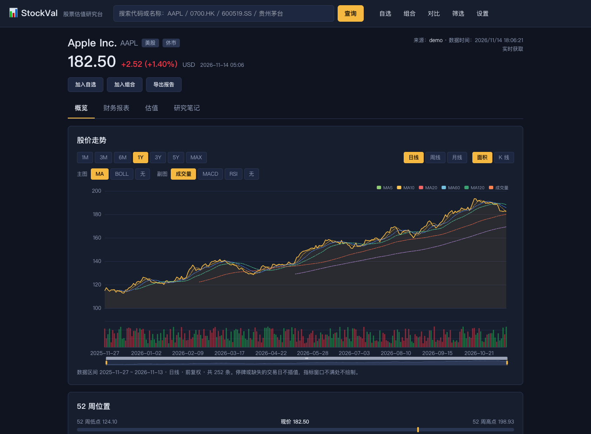
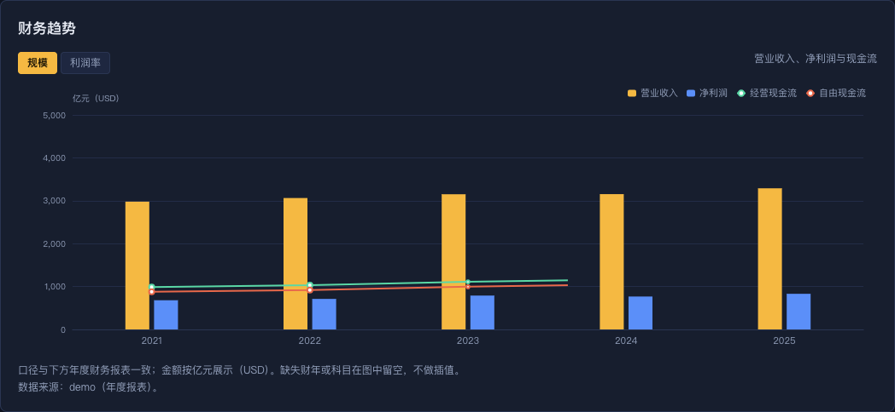
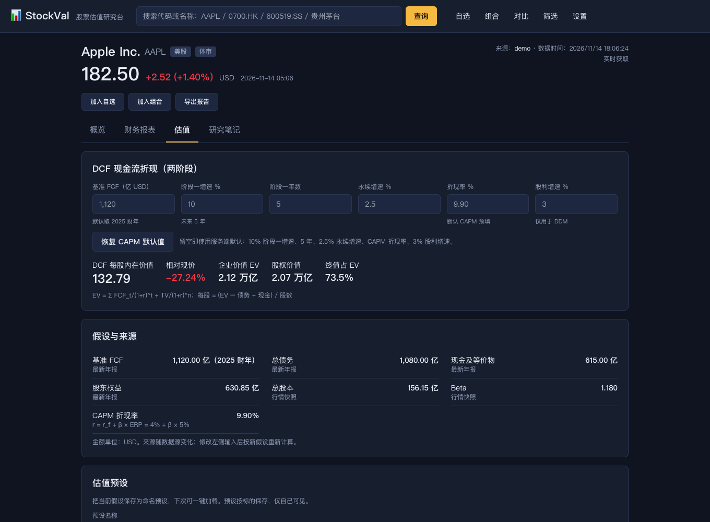
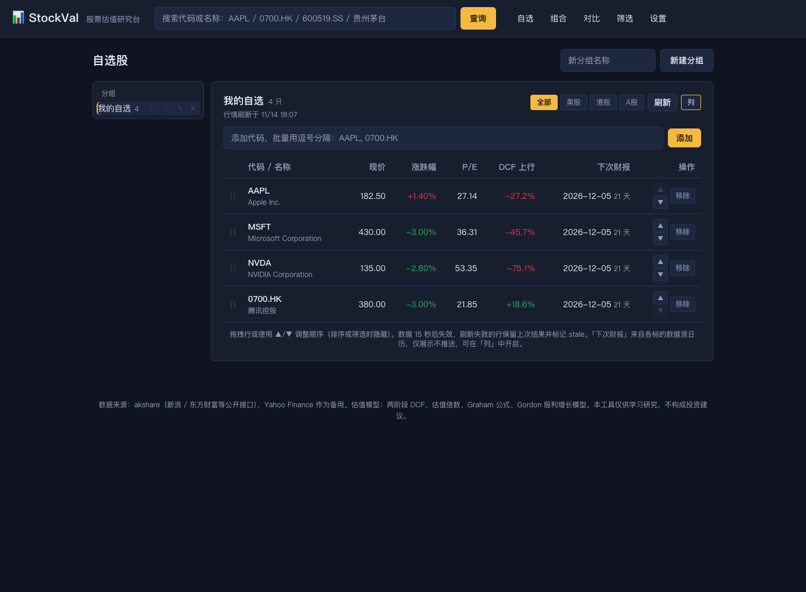
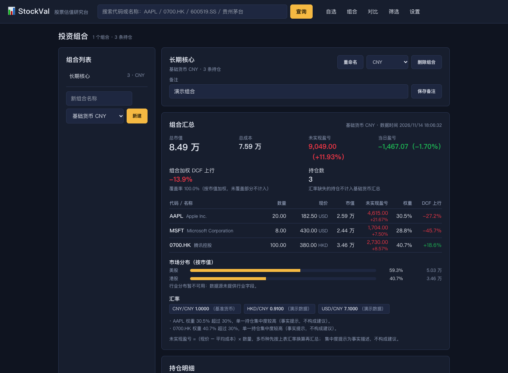
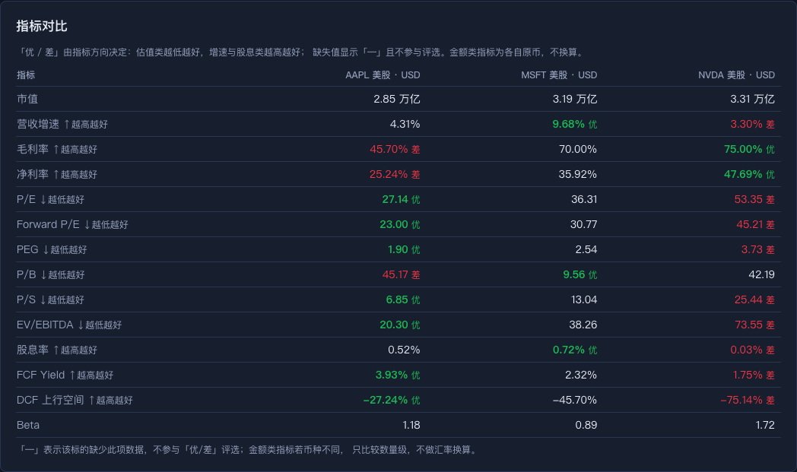
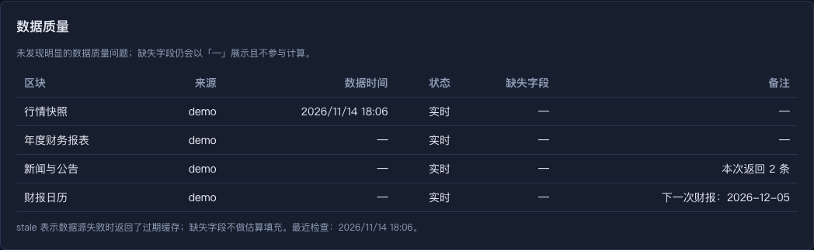

# StockVal 股票估值研究台

**把一家公司研究清楚，而不是盯着分时图。**

StockVal 是一个本地优先的个人股票研究与估值工作台，面向能看懂 P/E、自由现金流与折现率的个人投资者。搜索一只股票，
从行情、财务、新闻一路看到估值结论；调整假设、保存预设、横向对比、记录研究笔记，整个研究过程都在同一个界面完成，
并且每个数字都能追溯到数据来源与时间。

> ⚠️ 本工具仅供学习研究，**不构成投资建议**。估值结果取决于假设输入，DCF 等模型对增速、折现率等假设高度敏感。



## 为什么是 StockVal

市面上不缺行情软件，缺的是一个能把自己的研究过程沉淀下来的地方。StockVal 的取舍是：

- **不拼实时提醒，拼研究深度。** 免费公开数据源的延迟与可靠性无法与券商 App 相比，因此本项目不做提醒与推送，
  把精力放在财务解读、估值拆解、对比筛选与研究记录上。
- **数据真实、可追溯。** 缺失字段就是缺失，绝不填 0 或估算值；每个区块标注来源、时间、缓存与 stale 状态。
- **假设透明、可复现。** DCF、WACC、情景、反向 DCF、敏感性的每个输入与公式都能展开查看，结果随假设即时重算。
- **研究工作流闭环。** 搜索 → 自选 → 财务与新闻 → 估值 → 对比 → 笔记 → 组合，不需要在多个工具之间搬运数据。
- **本地优先。** 单机部署、SQLite 存储，自选、组合、预设与笔记都留在本机。

## 功能一览

### 个股研究

- **行情概览**：现价、涨跌幅、关键指标、52 周位置、交易时段、估值结论卡。
- **价格图表**：1M–MAX × 日/周/月，面积图与 K 线，成交量、MA、BOLL、MACD、RSI 副图。
- **年度财务**：营收、利润、现金流、资产负债的同比与 3 年 CAGR，缺失项单独列出。
- **财务趋势**：规模（营收/净利润/经营现金流/自由现金流）与利润率（毛利率/净利率/FCF 利润率）两个视图。
- **规则化解读**：基于确定性规则给出关注点与事实描述，不使用大模型生成结论。
- **财报日历**：下一次财报日与分红/除息日，仅展示，不做提醒。

### 估值工作台

- 两阶段与三阶段 DCF、Gordon 股利折现、Graham 数字、估值倍数。
- WACC 计算器、情景分析（概率加权）、反向 DCF（隐含增速）、敏感性表与热力图。
- 历史估值区间（P/E、P/B、P/S、FCF Yield 的 3/5 年分位）。
- 自定义权重的综合估值，权重合计必须为 100%。
- 估值预设的保存、加载、覆盖与**多预设并排对比**，直接看差异来自哪些假设。

### 自选、组合与筛选

- 多分组自选股，批量添加、排序、列配置、批量行情，单只失败不影响整表。
- 投资组合：持仓成本、市值、未实现/当日盈亏、权重、市场分布与集中度提示；多币种按汇率换算并标注。
- 多股对比（2–6 只）：归一化走势、指标优劣、统一假设估值，可保存常用对比组合。
- 筛选器：自定义代码、自选分组或预设指数为股票池，多条件筛选与预设保存。

### 信息与可信度

- 新闻与公告聚合，按 URL 与标题+时间去重，外链标注来源。
- **数据质量面板**：逐区块列出数据来源、更新时间、缓存/stale、缺失字段与交叉校验差异。
- 上游失败时优先返回带 `stale` 标记的过期缓存，而不是伪造数据。

### 研究记录

- **研究笔记**：按标的记录结论、关键假设与待验证问题，可关联估值预设，支持类型筛选与关键词检索。
- **估值预设**：把一组假设命名保存，下次一键加载；多个预设可直接对比结果。

## 页面截图

> 截图使用离线演示数据（`STOCKVAL_DEMO=1`），仅用于展示界面与功能。

| 财务趋势 | 估值工作台 |
|---|---|
|  |  |

| 研究笔记 | 自选股 |
|---|---|
|  |  |

| 投资组合 | 多股对比 |
|---|---|
|  |  |



## 快速开始

### Docker（推荐）

```bash
cp .env.example .env
# 修改 STOCKVAL_SECRET_KEY
docker compose up -d --build
```

打开 http://localhost:8080 ，首次访问创建管理员账号。

### 本地运行

后端需要 Python 3.13+：

```bash
cd backend
python3 -m venv .venv && source .venv/bin/activate
pip install -e ".[dev]"
uvicorn app.main:app --reload --port 8000
```

前端需要 Node 20+：

```bash
cd frontend
npm install
npm run dev
```

打开 http://localhost:5173 。首次访问会进入初始化页，创建账号后即可使用。

### 离线演示模式

不访问任何外部数据源，使用内置样本数据（AAPL、MSFT、NVDA、TSLA、0700.HK、600519.SS 等）：

```bash
cd backend
STOCKVAL_DEMO=1 uvicorn app.main:app --reload --port 8000
```

## 配置

配置通过环境变量注入，前缀 `STOCKVAL_`（也可写入 `backend/.env`）：

| 变量 | 默认值 | 说明 |
|---|---|---|
| `STOCKVAL_SECRET_KEY` | `dev-insecure-change-me` | **部署前必须修改** |
| `STOCKVAL_DATABASE_URL` | `sqlite:///./data/stockval.db` | 数据库路径 |
| `STOCKVAL_DATA_DIR` | `./data` | 数据与导出文件目录 |
| `STOCKVAL_DEMO` | `0` | `1` 启用离线演示数据 |
| `STOCKVAL_ENABLE_SCHEDULER` | `true` | 后台任务开关（导出清理、指数成分刷新等） |
| `STOCKVAL_ALLOWED_ORIGINS` | `http://localhost:5173` | CORS 白名单 |
| `STOCKVAL_LOG_LEVEL` | `INFO` | 日志级别 |

## 数据来源与口径

- **A 股**：akshare 接入新浪行情、东方财富财务报表与新闻、巨潮公告。
- **美股 / 港股**：新浪实时行情、东方财富财报与新闻；Yahoo Finance 作为备用源。
- **路由与降级**：按市场选择主数据源，失败时自动尝试备用源；仍失败且有过期缓存时返回 `stale` 数据并明确标注。
- **不保证实时**：公开接口存在延迟、限流与字段缺失，页面会展示数据时间与来源，请以原始披露为准。
- **缺失即 `null`**：界面显示「—」，不用 0 或估算值填充；只有公式推导（如 FCF = 经营现金流 − 资本开支）会参与计算并注明口径。
- **百分数使用百分点**：`10` 表示 10%。
- **金额保留原币**：组合汇总时才按汇率换算，并标注汇率与时间。
- **时间**：数据库存 UTC，界面按本地时区展示。

## 项目边界

- 单用户、本地部署，不做公开注册与多租户协作。
- 不接入券商、不做交易下单、不做资金流与 Level-2 行情。
- 不做提醒/推送：免费数据源的时效性不足以支撑可靠的提醒，相关范围已在 PRD v1.1 中取消。
- 不做回测引擎、组合优化、VaR 等专业风险模型。

## 项目状态

已完成 M0 架构、M1 基础研究能力、M2 研究深度与组合、M3 新闻信息流，以及 v1.1 研究能力增强
（财务趋势、估值预设对比、研究笔记、财报日历、数据质量面板、对比组合）。

正在进行 M4 交付阶段：PDF / Excel 研究报告导出、设置页、质量看板与部署文档。

产品需求与开发进度属于内部过程文档，不随仓库发布；对外的功能说明以本 README 为准。

## 开发与测试

```bash
cd backend
pytest tests -q
ruff check app tests

cd ../frontend
npm run typecheck
npm run build
```

## 免责声明

本工具仅供学习研究，不构成投资建议。估值结果取决于假设输入，DCF 等模型对增速、折现率等假设高度敏感，
请勿据此直接做出投资决策。数据来自公开接口，可能存在延迟、缺失或口径差异，请以公司公告与原始财报为准。
